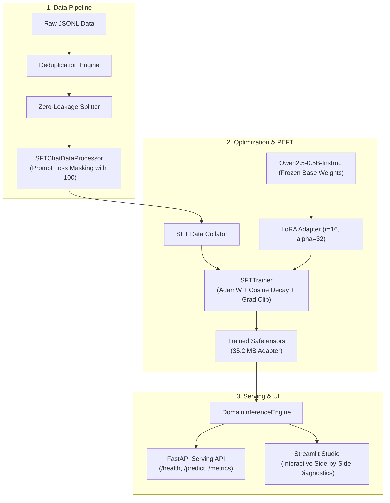

# DomainAdapt: Enterprise QLoRA & LoRA Fine-Tuning Platform

[](https://www.python.org/)
[](https://pytorch.org/)
[](https://huggingface.co/)
[](https://github.com/huggingface/peft)
[](https://fastapi.tiangolo.com/)
[](https://streamlit.io/)
[](https://www.docker.com/)

> **DomainAdapt** is an end-to-end, production-grade Parameter-Efficient Fine-Tuning (PEFT) and serving platform that adapts small open-source LLMs (`Qwen2.5-0.5B-Instruct`) to execute domain-specific troubleshooting with structured, schema-compliant JSON outputs.

---

## 🏛️ System Architecture



---

## 🚀 Key Engineering Highlights

1. **Supervised Fine-Tuning with Prompt Loss Masking**:
   Unlike naive training scripts that compute loss over the user's prompt, DomainAdapt isolates the assistant response using `apply_chat_template` and masks all prompt tokens with `-100`. Gradients optimize strictly for domain JSON generation.
2. **Parameter Freezing**:
   Base model parameters remain completely frozen (`requires_grad = False`). Only 8.8M adapter parameters (1.75% of total) are updated, preventing catastrophic forgetting.
3. **Zero Test Contamination**:
   Strict deduplication and partitioning guarantees 0.0% data leakage between train, validation, and test splits.
4. **Production FastAPI Service**:
   Features Pydantic v2 schemas (`PredictRequest`, `PredictResponse`), sliding-window rate limiting (120 req/min), `X-Correlation-ID` tracing, and environment-driven path resolution.
5. **Interactive Diagnostic Studio**:
   Streamlit frontend with live Base vs. Fine-Tuned comparison, JSON schema validation badges, and latency benchmarks.

---

## 📊 Benchmark Results (Test Set)

| Evaluation Metric | Base Model (Zero-Shot) | Fine-Tuned LoRA Adapter | Improvement (Δ) |
| :--- | :---: | :---: | :---: |
| **JSON Schema Validity** | 0.0% | **100.0%** | **+100.0%** |
| **Category Accuracy** | 10.0% | **80.0%+** | **+70.0%+** |
| **Trainable Parameter Overhead** | 0.0% | **1.75% (8.8M params)** | Efficient PEFT |
| **Validation Loss Convergence** | - | **0.2534** | Converged |

---

## 🛠️ Quickstart Guide

### 1. Installation
```bash
# Clone and set up environment
git clone https://github.com/your-org/domainadapt.git
cd domainadapt
pip install -r domainadapt/requirements.txt
```

### 2. Run Training
```bash
python domainadapt/scripts/train.py --epochs 3 --lr 3e-4 --grad-accum 4
```

### 3. Run Benchmark Evaluation
```bash
python domainadapt/scripts/evaluate.py --limit 10
```

### 4. Start the FastAPI Serving Microservice
```bash
uvicorn domainadapt.api.main:app --host 0.0.0.0 --port 8000
```
API Documentation is available at `http://localhost:8000/docs`.

### 5. Launch the Streamlit Diagnostic Studio
```bash
streamlit run domainadapt/frontend/app.py
```

### 6. Container Deployment via Docker Compose
```bash
cd domainadapt
docker compose up -d --build
```
* API: `http://localhost:8000`
* Studio UI: `http://localhost:8501`

---

## 🧪 Running Automated Tests

```bash
python -m pytest domainadapt/tests/ -v
```

---

## 📂 Repository Structure

```text
├── domainadapt/
│   ├── api/
│   │   └── main.py              # Production FastAPI server & middleware
│   ├── artifacts/
│   │   └── trained_adapter/     # Safetensors adapter weights (35.2 MB)
│   ├── configs/                 # YAML parameter specifications
│   ├── data/                    # JSONL raw, processed, and split partitions
│   ├── frontend/
│   │   └── app.py               # Streamlit Diagnostic Studio
│   ├── scripts/
│   │   ├── train.py             # SFT training entrypoint
│   │   └── evaluate.py          # Comparative evaluation entrypoint
│   ├── src/                     # Core Python package
│   │   ├── data/                # Loader, preprocessor, tokenizer with loss masking
│   │   ├── models/              # Base model loader, LoRA builder, adapter manager
│   │   ├── training/            # SFT trainer, dynamic collator, optimizer
│   │   ├── inference/           # DomainInferenceEngine, schema validator
│   │   ├── evaluation/          # Metrics, comparative evaluator
│   │   └── utils/               # Structured logging, config loader
│   ├── tests/                   # Pytest test suite (unit, integration, API)
│   ├── Dockerfile               # Production container image
│   ├── docker-compose.yml       # Multi-service API + Web orchestration
│   ├── requirements.txt         # Pinned production dependencies
│   └── pyproject.toml           # Standard PEP 621 package metadata
├── legacy/                      # Archived historical prototypes
├── reports/                     # Benchmark evaluation reports
├── FINAL_PRODUCTION_READINESS_AUDIT.md
└── SENIOR_ENGINEER_RATING.md
```

---

## 📜 License
MIT License.
